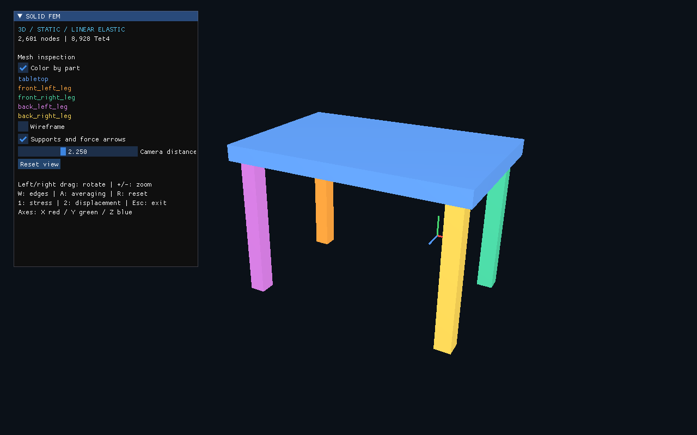

# Solid FEM

A small 3D linear elastic FEM solver in Python and Taichi. The code follows the
main calculation directly and assumes valid meshes, materials, loads, and supports.

## Run

Python 3.10–3.12:

```bash
python3 -m venv .venv
source .venv/bin/activate
python -m pip install -e '.[dev]'
python -m fem mesh/example/cantilever.json
```

Other useful commands:

```bash
python -m fem mesh/example/cantilever.json --no-view
python -m fem mesh/example/cantilever.json --screenshot output/beam.png
python -m fem mesh/example/cantilever.msh --mesh-only
python -m fem mesh/example/tension.json
```

The example mesh has 3,321 nodes and 15,360 tetrahedra. Regenerate it with
`python mesh/example/generate_mesh.py`; its size and divisions are in `input.box_mesh()`.
The solver writes `output/<case name>.vtu`. Use `--output path/to/result.vtu` to
choose another path. VTU files contain the complete volume results for ParaView.

## Parametric objects from JSON

Define an object as named rectangular solids in metres. Start with
[`mesh/table.json`](mesh/table.json): its parameters control the width, depth,
height, tabletop thickness, leg width, and inset. Parts use arithmetic expressions
such as `"height - top_thickness"` so dimensions stay connected when edited.

```bash
# Build the mesh and generated analysis case.
python -m fem.construct mesh/table.json

# Build and open the colored part preview. Close it with Esc.
python -m fem.construct mesh/table.json --preview

# Inspect the exported mesh, or solve the generated case.
python -m fem mesh/table.msh --mesh-only --up y
python -m fem mesh/table.case.json --up y
```



The constructor uses NumPy and meshio, already installed with the solver. It does
not require STEP, Gmsh, or a CAD application. Its shared grid generates conforming
Tet4 elements: touching parts reuse the same nodes, representing perfect bonds.
Names are retained as physical volume groups in `.msh`; named exterior face groups
become support and load selections. The preview colors and labels each part.
Toggle **Color by part** in the solver viewer to identify parts there too.

The example builds 2,601 nodes and 8,928 tetrahedra. Its generated case fixes the
four feet and applies a total downward force of 1,000 N to the tabletop, using one
homogeneous material with E = 70 GPa and Poisson ratio 0.3. A sample solve takes
about 0.4 seconds here. These material and load values are editable example inputs.

The allowed geometry is deliberately limited to axis-aligned boxes with positive
dimensions and face-to-face joints. Overlaps, disconnected pieces, edge/point-only
joints, and empty face groups are rejected during construction. Partial face
contacts (a narrow leg meeting a wide tabletop) are supported. There are no
rotations, curves, contact, sliding joints, or multiple materials in this version.

See [the format guide](docs/box-model.md) and
[the JSON schema](mesh/box-model.schema.json) for editing details. The example's
`$schema` entry enables editor validation and face-name suggestions.

## Read the code in this order

| File | Main job |
|---|---|
| `src/fem/__main__.py` | Load the case, solve it, export it, open the viewer |
| `src/fem/construct.py` | Build a conforming mesh and case from named boxes |
| `src/fem/input.py` | Data containers, mesh loading, JSON, supports, and loads |
| `src/fem/elasticity.py` | Taichi kernels for element stiffness, strain, and stress |
| `src/fem/solver.py` | Assemble the global matrix and solve the free displacements |
| `src/fem/results.py` | Von Mises stress, nodal averaging, and VTU export |
| `src/fem/viewer.py` | Mesh drawing, heatmap, camera, and GUI |

The main calculation is:

```text
mesh + material + supports + forces
    -> element stiffness
    -> global stiffness K
    -> solve displacement u
    -> recover strain and stress
    -> export and render
```

Each node has three displacement DOFs: x, y, z. A four-node tetrahedron has 12.
The stiffness equation is `K_e = V B.T D B`. The Taichi kernel explicitly builds
the strain-displacement matrix `B` from shape-function gradients and the material
matrix `D` from the Lamé constants, then multiplies them. `B` uses engineering
shear strain in order `[xx, yy, zz, gamma_xy, gamma_yz, gamma_xz]`.

`solver.solve()` is organized into four steps:

1. Calculate element stiffness and assemble the global sparse matrix.
2. Fill prescribed displacements and find the free DOFs.
3. Solve `K_ff u_f = force_f - K_fc u_c` with SciPy.
4. Calculate support reactions, strain, stress, and von Mises stress.

Strain is `0.5 * (grad_u + grad_u.T)` and stress is
`2 * mu * strain + lambda * trace(strain) * I`. Tensor components are stored in
order `[xx, yy, zz, xy, yz, xz]`; strain uses tensor shear.

Physics uses float64 on the CPU. Display buffers use float32. The solve finishes
before the viewer starts; rotating the block moves the camera.

## Case file

Use metres, newtons, and pascals. The mesh path is relative to the JSON file.
For example:

```json
{
  "mesh": "part.msh",
  "material": {"young": 70000000000.0, "poisson": 0.3},
  "constraints": [
    {"select": {"axis": "x", "at": "min"}, "displacement": [0, 0, 0]}
  ],
  "loads": [
    {"select": {"axis": "x", "at": "max"}, "force": [0, 0, -1000]}
  ]
}
```

Inputs are four-node tetrahedral volume meshes, such as `.msh` or `.vtu`.
The implementation contains no custom input validation or support checks;
errors come directly from Python, meshio, NumPy, or SciPy.

Selectors can use:

| Selector | Example |
|---|---|
| Axis plane | `{"axis": "x", "at": "min"}` or `{"axis": "z", "at": 0.02}` |
| Box | `{"box": [[0, 0, 0], [0.1, 0.2, 0.3]]}` |
| Node IDs | `{"nodes": [0, 3, 8]}` |
| Imported group | `{"group": "support"}` |

`tol` sets the coordinate tolerance; its default is `1e-8` times the largest
mesh extent. Node IDs are zero-based. Imported cell groups select their nodes.

`displacement` lists x/y/z components. `null` leaves a component free, so
`[0, null, null]` prescribes x only. Later prescriptions overwrite earlier ones.
Forces add. The default `"distribution": "total"` divides the force equally among
selected nodes; `"per_node"` applies that vector to every selected node.

## Viewer

- Left- or right-drag in the scene to rotate. Use `+` / `-` or the camera slider to zoom.
- `1`: von Mises stress. `2`: displacement. **Next result** also offers XX/YY/ZZ stress.
- `W`: wireframe. `A`: stress averaging. `R`: reset. `Esc`: close.
- The deformation slider changes the drawn displacement scale.
- Green dots show supports; pink arrows show forces. Axes: X red, Y green, Z blue.

Raw Tet4 stress is constant in each element. The smooth view averages incident
stress tensors at nodes using volume weights, then computes von Mises stress.
The color range covers the whole volume. The renderer draws exterior triangles;
use ParaView to slice exported volume data.

The model is static, small-strain, homogeneous isotropic linear elasticity.
There is no contact, plasticity, dynamics, or automatic tetrahedral mesher.

## Numerical tests

```bash
PYTEST_DISABLE_PLUGIN_AUTOLOAD=1 python -m pytest -q
ruff check src tests mesh
ruff format --check src tests mesh
```

The tests cover element stiffness against an independent NumPy calculation,
rigid motion, affine strain, the constant-strain patch, Poisson contraction,
force/moment/energy balance, mesh convergence, selectors, averaging, and VTU I/O.
The constructor tests also verify volume, shared faces at joints, part/group
round trips, parameter edits, reaction balance, and invalid construction rules.
The analysis loader and solver retain their simple valid-input assumptions.
